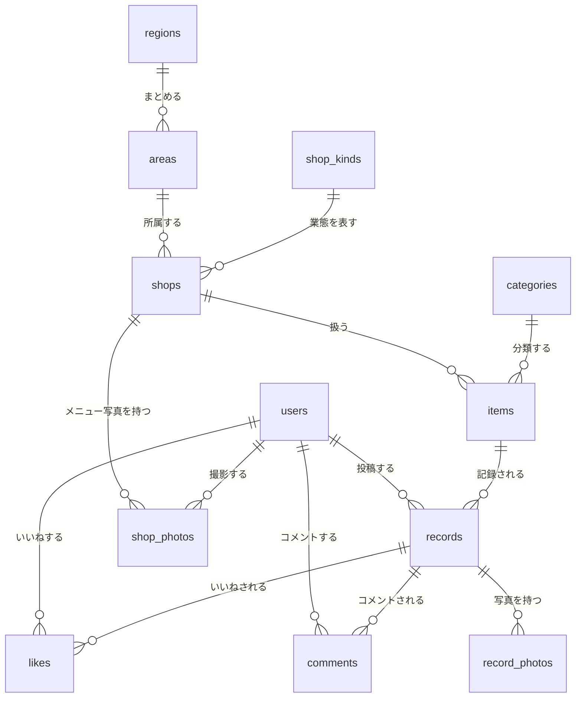

# ER図・テーブル設計

## ER図



## テーブル定義

### users（利用者）

- id
- nickname
- bio
- profile_photo_url
- role
- created_at
- updated_at

**設計判断:** `id` は Supabase Auth の JWT に含まれる `sub`（UUID）をそのまま使う（`CHAR(36)`）。
連番の内部IDは持たない。JWT から取り出した値でそのまま検索でき、対応表が不要になるため。

ユーザーの作成は、初回ログイン時に Next.js が登録APIを呼ぶ方式とする（[要件定義](要件定義.md) 参照）。

### categories（分類マスタ）

- id
- category_name
- category_emoji
- created_at
- updated_at

### shop_kinds（業態マスタ）

- id
- shop_kind_name
- shop_kind_emoji
- created_at
- updated_at

### regions（地域マスタ）

- id
- region_name
- created_at

**設計判断:** `areas` をまとめる上位の単位。国内の地方（関東・近畿など）と、
海外の地域（東アジア・ヨーロッパなど）の両方を扱うため、「地方」ではなく「地域」とする。

エリアの選択画面で地域ごとにグループ表示するために使う。
47都道府県に海外を加えると81件になり、平らに並べると選びにくいため。

| 地域 | エリア |
|---|---|
| 北海道・東北 / 関東 / 中部 / 近畿 / 中国・四国 / 九州・沖縄 | 都道府県（47件）|
| 東アジア / 東南アジア・南アジア / ヨーロッパ / 北米 / 中南米 / オセアニア / 中東 / アフリカ | 国（34件）|

国内を6区分にしているのは、北海道だけが1件のグループになるのを避けるため。
各グループが7〜9件で揃う。

`updated_at` は持たない。地域名は変わらないため。

### areas（エリアマスタ）

- id
- region_id
- area_name
- created_at

**設計判断:** 都道府県と国を同じテーブルで扱う。店の一意性の単位（`UNIQUE (shop_name, area_id)`）
であるため、粒度を揃える必要がある。海外を大陸単位にすると「パリの店」と「ロンドンの店」が
同一になってしまうため、国単位とする。

海外はすべての国を登録せず、代表的な国と各地域の「その他○○」を用意する。
マスタの追加は管理者が行えるため、必要になった時点で足せばよい。

`updated_at` は持たない。エリア名は変わらないため。

表示順は `id` 順とする（初期データを表示したい順に投入する）。
将来、管理者が追加したエリアは末尾に並ぶが、意図して追加したものであるため許容する。

### shops（店）

- id
- shop_name
- area_id
- shop_kind_id
- is_closed
- created_at
- updated_at

UNIQUE (shop_name, area_id)

**設計判断:** `is_closed` は閉店したかどうかを表す。店は削除できないため、
閉店した店はこのフラグで扱う。過去の記録は残したまま、新しい記録の対象から外すことが目的。

| 場面 | 閉店した店の扱い |
|---|---|
| 店一覧 | 表示する（「閉店」バッジを付け、末尾にまとめる） |
| 記録・写真の登録での店の選択 | **候補に出さない**（もう行けないため） |
| 検索の「まだ食べていない」 | **除外する**（もう食べられないため） |
| 過去の記録・写真 | そのまま残す |

閉店の入力は店の編集画面から行い、**全ユーザーが変更できる**（店名や業態の編集と同じ方針）。

店は「正規化した店名 + 都道府県」で一意とする。`place_id` は保存しない。
Google Places は店名と都道府県を取得する入力補助としてのみ使う。
チェーン店は支店名を外して登録し、同一都道府県内の別店舗で買った商品を同じ商品として扱う。
登録フローと受け入れる制約は [要件定義](要件定義.md) を参照。

### items（商品）

- id
- shop_id
- item_name
- category_id
- is_seasonal
- created_at
- updated_at

UNIQUE (shop_id, LOWER(item_name))   ← 同じ店の中で、大文字小文字だけが違う商品名（Latte / latte）は1つだけ（V4。[文字コードと照合順序](#文字コードと照合順序) 参照）

**設計判断:** `category_id` と `is_seasonal` は商品の属性であり、記録ごとには変わらない。
記録の登録画面で商品を新規作成するときに指定し、既存の商品を選んだ場合は設定済みの値を引き継ぐ。
`category_id` は **NOT NULL**（必須）とする。未分類の商品があると分類での絞り込みから漏れ、
ホームの分類ごとの件数も不正確になるため。入力の手間を抑えるため、
`categories` マスタに「その他」を用意し、迷ったときの逃げ道とする。

`items` は全ユーザーで共有するマスタであり、**分類と季節限定の変更は全ユーザーに許可する**。
管理者に限定すると、他ユーザーが誤りを見つけても修正できず運用が滞るため。
一方、分類・業態の**種類そのものを追加する**操作は管理者のみとする（[要件定義](要件定義.md) 参照）。

商品名の表記ゆれは、入力補助（既存商品のサジェスト）と保存前の正規化で防ぐ。

**商品名も編集できる。** 打ち間違いで登録された商品が入力補助の候補に残り続けるのを防ぐため。
商品IDは変えないため、過去の記録は新しい商品名で表示される。
変更後の商品名が同じ店にすでにある場合は拒否する（[要件定義](要件定義.md) の「商品の編集」参照）。

### records（記録）

- id
- user_id
- item_id
- eaten_on
- custom_note
- review
- rating
- price
- created_at
- updated_at

**設計判断:** `is_public` は持たない。MVP では全記録を公開扱いとする。

`review` は食べた感想を書く欄。`rating`（星評価）と対になる。
`comments` テーブル（他ユーザーが書くコメント）と紛らわしいため、列名を `comment` から変更した。
`custom_note` は注文内容の記録（次回そのまま再現するためのメモ）であり、役割が異なる。

`price` は支払った金額であり、値上げや店舗差で変わるため商品ではなく記録に持たせる。
NULL を許容する（毎回の入力を必須にすると記録が続かないため）。
同じ商品の記録を時系列で並べると、価格の推移が読み取れる。

**削除方針:** 記録の削除は物理削除（`DELETE`）とする。論理削除は行わない。

MySQL と Supabase Storage は1つのトランザクションにできないため、順序を定める。

1. MySQL 内で `records`・`record_photos`・`likes`・`comments` をトランザクションで削除する
2. コミットが成功してから、その記録に紐づく写真（複数枚）を Storage から削除する
3. 手順2が失敗した場合は、日次バッチが後から回収する（[要件定義](要件定義.md) 参照）

Storage の無料枠が 1GB のため、参照されない画像を残さない。

**記録の一覧（#4）の取得:** 自分の記録を `eaten_on DESC, id DESC` で並べ、cursor（前のページの最後の `eaten_on` と `id`）で続きを読む。
`idx_records_user_eaten (user_id, eaten_on)` を使う（InnoDB の副インデックスは主キーの `id` も持つため、並びと cursor の両方に使える）。
年の絞り込みは `YEAR(eaten_on)` ではなく、日付の範囲（その年の 1/1 以上・12/31 以下）で行う。
代表写真と写真の枚数は、一覧の SQL では取らず、取得したカードの記録 ID をまとめて渡して `record_photos` を別に1回で取得する。

使い捨ての MySQL 8.4.13（記録 2 万件・1 人 1,000 件・写真 約 1.3 万枚）で EXPLAIN と読み取り操作数（`Handler_read_*` の差分）を確認した。
最初のページ・続き・年の絞り込みは、`idx_records_user_eaten` を後ろから読み、読み取り操作は約 20 回だった。
**業態の絞り込みでは、一時テーブルと並べ替えが発生する**（`shops` → `items` → `records` の順にたどる。読み取り操作は約 1,500 回）。
現時点ではインデックスを追加しない。この順にたどるため、本人の記録数だけでなく、同じ業態の店・商品・ほかの利用者の記録が増えると読み取り量が増える。
それらの件数が増えたときに、実行時間と読み取り量を再計測する。

### likes（いいね）

- id
- record_id
- user_id
- created_at

UNIQUE (record_id, user_id)   ← 同じ記録に同じ人が2回いいねできない（DB制約）

**削除方針:** 記録を削除したときは、紐づくいいねも同時に削除する
（外部キーに `ON DELETE CASCADE` を設定する）。

**業務ルール（アプリ側で実装）:**
自分の記録にはいいねできない。DB制約では表現できないため、Service 層で
likes.user_id != records.user_id を検証する。

### record_photos（記録の写真）

- id
- record_id
- photo_path
- sort_order
- created_at

UNIQUE (record_id, sort_order)

**設計判断:** 1つの記録に複数枚の写真を持たせる。撮った写真から1枚を選ばせるのではなく、
そのまま残せるようにするため（「写真は撮っているのに探せない」という課題に対応する）。

ここに入るのは**商品の写真だけ**である。種類を区別する必要がないため、`photo_type` は持たない。

メニューと店の写真は、食事の記録ではなく**店の情報**であり、食事をしなくても撮ることがある。
そのため [shop_photos](#shop_photos店の写真) に分離している。

`sort_order` の先頭を**代表写真**とし、記録の一覧・写真タブ・カレンダーではそれを表示する。
複数枚あることは枚数バッジで示し、記録の詳細で全枚数を閲覧できるようにする。

`(record_id, sort_order)` に一意制約を張る。既定値が 0 のため、アプリ側で設定を忘れると
同じ記録に `sort_order = 0` の写真が複数登録され、**代表写真が定まらなくなる**。
並べ替えは、その記録の写真をすべて削除して入れ直す（1記録あたり最大5枚のため負荷は小さい）。

`updated_at` は持たない。写真は差し替えではなく、追加と削除で管理するため。

Storage 上の置き場所は `{user_id}/records/{UUID}.webp` とする。第1要素を `user_id` に
するのは Supabase Storage のアクセス制御がパスの第1要素を見るため、第2要素で種類を
分けるのは孤児ファイルを掃除するバッチが `shop_photos` の写真を誤って削除しないため
（[要件定義](要件定義.md) 参照）。

`photo_path` には公開URLではなくパスを保存する。URL の前半は環境ごとに変わるため、
DB には環境に依存しない値だけを持たせる。

**業務ルール（アプリ側で実装）:**
1記録あたりの写真は**最大5枚**とする。Supabase Storage の無料枠が 1GB のため。
1枚を約150KBに圧縮する前提で、1日1記録・5枚を上限まで使い続けた場合に約3年10か月分に相当する
（利用者が増えると容量は全体で共有されるため、その分早く到達する）。

**削除方針:** 記録を削除したときは、紐づく写真の行も同時に削除する
（外部キーに `ON DELETE CASCADE` を設定する）。Storage の実ファイルは、
`records` の削除手順に従ってコミット後に削除する。

### shop_photos（店の写真）

- id
- shop_id
- user_id
- photo_path
- photo_type
- taken_on
- created_at
- shopfront_key（生成カラム）

**設計判断:** メニューと店の外観の写真は**店に直接紐づける**。理由は3つ。

1. これらは食事の記録ではなく**店の情報**である
2. 「店に行ったが食べずに撮った」場合に、記録がなくても登録できる
3. 記録の写真枚数（最大5枚）を消費しない

`taken_on` は撮影日。記録の登録画面から追加した場合は `records.eaten_on` を、
店の詳細から直接追加した場合は当日を既定値とする。
同じ店でメニューを撮り直すたびに時系列で溜まり、店の詳細では新しい順に並ぶため、
**メニュー改定や価格改定を後から比較できる**。

`photo_type` は `menu`（メニュー表）/ `shopfront`（店の写真）。表示先が異なる。

| 種類 | 店一覧 | 店の詳細 |
|---|---|---|
| `shopfront`（店の写真） | **サムネイルとして表示** | ヘッダーに表示 |
| `menu`（メニュー表） | — | 撮影日の新しい順に一覧 |

店一覧は業態の絵文字だけでは見分けがつきにくいため、店の写真があればそれを優先して表示し、
なければ業態の絵文字を出す。

`updated_at` は持たない。写真は差し替えではなく、追加と削除で管理するため。

Storage 上の置き場所は `{user_id}/shops/{UUID}.webp` とする（`record_photos` とは第2要素で分離する）。

**業務ルール（アプリ側で実装）:**
上限は種類ごとに異なる。

| 種類 | 上限 | 理由 |
|---|---|---|
| `menu`（メニュー表） | 1回の登録につき10枚。**累積は無制限** | 複数ページにわたる。撮り直しを時系列で残すことが目的 |
| `shopfront`（店の写真） | **1人1店舗につき1枚** | 表示に使うのは最新の1枚だけで、古いものは使われないため |

外観写真を撮り直した場合は、**その人自身の前の写真と差し替える**（アップロード時に
自分の `shopfront` があれば削除する）。他人の写真は削除しない。
店一覧のサムネイルには、`taken_on` が最新の `shopfront` を使う。

DB 側でも重複を防ぐ。MySQL は条件付きの一意制約を書けないため、生成カラムを使う。

```sql
shopfront_key VARCHAR(80) GENERATED ALWAYS AS (
  IF(photo_type = 'shopfront', CONCAT(shop_id, ':', user_id), NULL)
) STORED,
CONSTRAINT uk_shop_photos_shopfront UNIQUE (shopfront_key)
```

`menu` の行では `shopfront_key` が NULL になる。MySQL の一意制約は NULL どうしを重複とみなさないため、
メニュー写真は何枚でも登録できる。MySQL には条件付きの一意制約がないため、生成カラムで代用している。

削除できるのは**撮影した本人と管理者のみ**。`shops` は全ユーザー共有のため、
他人が撮った写真を勝手に消せないようにする。

管理者の判定は MySQL の `users.role` で行うため、Supabase Storage のポリシーだけでは判定できない。
本人の削除はブラウザから直接、管理者の削除は Spring Boot 経由でサーバー側の権限を使う
（[要件定義](要件定義.md) 参照）。

### comments（コメント）

- id
- record_id
- user_id
- comment_text
- created_at
- updated_at

**削除方針:** 記録を削除したときは、紐づくコメントも同時に削除する
（外部キーに `ON DELETE CASCADE` を設定する）。

**業務ルール（アプリ側で実装）:**
コメントの編集・削除は投稿者本人のみ。他ユーザーは閲覧のみ可。

## 文字コードと照合順序

全テーブルの既定は `utf8mb4` / `utf8mb4_0900_ai_ci`。
ただし **`items.item_name` は `utf8mb4_ja_0900_as_cs`**（`V3__use_japanese_collation_for_names.sql`）、
**`shops.shop_name` は `utf8mb4_ja_0900_as_cs_ks`**（V3 のあと `V5__distinguish_kana_in_shop_names.sql` で変更）とする。
さらに商品名だけは、**大文字小文字だけが違う名前を同じ商品とする**（`V4__ignore_letter_case_in_item_names.sql`）。
V4・V5 の判断は、下の「[店名・商品名の書き方の違い](#店名商品名の書き方の違いv4v5)」。

### 既定のままだと何が起きるか

`utf8mb4_0900_ai_ci` は**アクセント（濁点・半濁点）と大文字小文字を区別しない**。
MySQL で確認した結果は次のとおり。

| 比べたもの | `utf8mb4_0900_ai_ci` | `utf8mb4_ja_0900_as_cs` |
|---|---|---|
| スターバックス / スターパックス | 同じ | **別** |
| ハム / はむ | 同じ | 同じ |
| ABC / abc | 同じ | **別** |

店名と商品名には（V3 の時点で）`UNIQUE (shop_name, area_id)` / `UNIQUE (shop_id, item_name)` があり、
同じ店・同じ商品かどうかの判定にも使う（商品の UNIQUE は、のちに V4 で `(shop_id, (LOWER(item_name)))` に変えた）。既定のままだと、濁点だけが違う別の店・別の商品を
**同じものとして扱ってしまい、登録し直すこともできない**。

```
大阪府に「パン工房ミナミ」が登録済みの状態で「バン工房ミナミ」を登録しようとすると

  アプリの重複判定（店名 + エリアで検索）  → 既存の「パン工房ミナミ」が見つかり、それが返る
  DB に直接 INSERT した場合               → UNIQUE 制約違反で登録できない
```

### `utf8mb4_ja_0900_as_cs` を選んだ理由

| 候補 | 濁点 | かな | 大文字小文字 | 判断 |
|---|---|---|---|---|
| `utf8mb4_0900_ai_ci`（既定）| 同じ | 同じ | 同じ | 濁点が区別できない |
| **`utf8mb4_ja_0900_as_cs`** | **別** | 同じ | 別 | **採用** |
| `utf8mb4_ja_0900_as_cs_ks` | 別 | 別 | 別 | かなの違いまで分けると表記ゆれが増える |
| `utf8mb4_bin` | 別 | 別 | 別 | 同上 |

「たまごサンド」と「タマゴサンド」が同じ商品になるのは、表記ゆれを減らす目的に合う。
一方、濁点の違いは別の言葉なので区別する。

大文字小文字を区別するようになるため「Starbucks」と「STARBUCKS」は別の店になるが、
店名は Google Places の候補から選ぶためばらつきは少ない。
**誤って統合されるほうが後から直せない**ぶん問題が大きいと判断した。

（V3 の時点の判断。のちに、商品名は大文字小文字も同じとし（V4）、店名はかなも区別する（V5）ことにした。
下の「店名・商品名の書き方の違い」）

### 検索での扱い

検索（[要件定義](要件定義.md) の機能 #6）は「候補を広めに出して目で選んでもらう」処理であり、
取りこぼしを避けたい。そこで列の照合順序は厳しいままにして、
**検索の SQL の中でだけ `COLLATE utf8mb4_0900_ai_ci` を指定する**。

| 一致してほしいもの | `ja_0900_as_cs`（列の既定）| `ai_ci` を指定したとき |
|---|---|---|
| 「ぱん」と「パン」 | 一致する | 一致する |
| 「ABC」と「abc」 | 一致しない | **一致する** |
| 「パン」と「バン」 | 一致しない | **一致する** |

ひらがな・カタカナの違いは採用した照合順序がもともと吸収するため、**それだけが目的なら
`ai_ci` の指定は不要**である。指定する目的は、大文字小文字と濁点の違いも吸収することにある。

濁点まで一致させると関係のない店・商品が候補に混じるが、検索は選び直せるため実害は小さい。
一方、登録と重複判定は「1件に決める」処理なので、こちらは厳しい照合順序のままにする。

### 店名・商品名の書き方の違い（V4・V5）

**商品名は、同じ店の中でひらがな・カタカナや大文字小文字だけが違う名前（「ラテ」と「らて」、「Latte」と「latte」）を同じ商品とする。
店名は、どちらの違いも区別して別の店とする。**

| | 商品名 | 店名 |
|---|---|---|
| ひらがな・カタカナの違い | 同じ商品（V3 から） | **別の店**（V5） |
| 英字の大文字小文字の違い | **同じ商品**（V4） | 別の店（V3 から） |
| 重複の判定（UNIQUE と登録前の検索） | LOWER 一致 | 完全一致（列の照合順序 `utf8mb4_ja_0900_as_cs_ks`） |
| 候補の並び | LOWER 一致 → そのほかの部分一致（名前順） | 完全一致 → **かな・大文字小文字の違いを吸収した一致** → そのほかの部分一致（名前順） |

濁点・半濁点、小さいかな（「きゃ」と「きや」）、半角カナ、丸数字は、店名・商品名とも区別する。

この節の言葉は次の意味で使う。

| 言葉 | 意味 |
|---|---|
| 完全一致 | 列の照合順序で `=` が一致すること。商品名（`utf8mb4_ja_0900_as_cs`）はひらがなとカタカナを同じとし、店名（`utf8mb4_ja_0900_as_cs_ks`）は区別する。全角と半角の英字は、どちらも同じとして扱われる |
| LOWER 一致（商品名） | MySQL の `LOWER()` で小文字にしてから、列の照合順序で `=` が一致すること。英字（ASCII）だけでなく、`LOWER()` が小文字にする文字（「É」など）すべてに効く。特別な文字への独自の対応はせず、MySQL の動きに従う |
| かな・大文字小文字の違いを吸収した一致（店名の候補） | 店名を `utf8mb4_ja_0900_as_cs`（かなを同じとみなす）に切り替え、`LOWER()` どうしで比べた一致（`LOWER(shop_name COLLATE utf8mb4_ja_0900_as_cs) = LOWER(#{…})`）。列の設定や保存値は変わらない。濁点・小さいかな・半角カナの違いまでは吸収しない |

**商品名をまとめる理由：** 同じ店のメニューに、かなや大文字小文字だけが違う別の商品はほぼない。
一方、商品名には外部のマスタがなく手で入力するため、書き方がばらつきやすい。

**店名をまとめない理由：** 店は支店名を外して「店名 + 都道府県」でまとめるため、県全体で名前がぶつかりやすい。
同じ都道府県に、書き方だけが違う別の個人店（「CAFE」と「cafe」、「さくら」と「サクラ」）がありうる。
誤ってまとめるほうが後から直せないため、店名は区別したまま、候補で上に出して気づきやすくする。
また、フロントエンドの店の選択は店名を `===` で比べていて、もともとかなを区別している。
V5 で、画面とバックエンドの判断がかなの違いについてそろう。

**V5 の作り：** `shops.shop_name` の照合順序を `utf8mb4_ja_0900_as_cs` から `utf8mb4_ja_0900_as_cs_ks` に変える。
`_ks` は、かなを区別する（kana sensitive）ことだけを足したもので、ほかの区別は変わらない（MySQL 8.4.11 で確認。1 = 同じ、0 = 別）。

| 比べたもの | `ja_0900_as_cs`（V3） | `ja_0900_as_cs_ks`（V5） |
|---|---|---|
| さくら / サクラ | 1 | **0** |
| すたーばっくす / スターバックス | 1 | **0** |
| ABC / abc | 0 | 0 |
| ＡＢＣ / ABC | 1 | 1 |
| パン / バン | 0 | 0 |
| きゃべつ / きやべつ | 0 | 0 |
| ガ / カ＋結合濁点 | 1 | 1 |

区別を増やす変更なので、V5 で UNIQUE の重複が新しく起きることはない。
UNIQUE と登録前の検索（通常・ForShare）は列の照合順序に従うので、SQL は変えていない。
ただし、V5 より前に「同じ店」として使われた記録を、自動で別の店に分けることはしない。
名前順（`ORDER BY shop_name`）も新しい照合順序で並ぶので、同じ順位の中やキーワードがないときの候補の並びにも、かなの区別が加わる。

**照合順序を変えずに LOWER() にした理由：** 列の照合順序を `utf8mb4_0900_as_ci` に変えても大文字小文字は同じになるが、
ほかの違いまで同じと判定され、別の商品が1つにまとめられてしまう。MySQL 8.4.11 で確認した結果は次のとおり（1 = 同じ、0 = 別）。

| 比べたもの | `ja_0900_as_cs`（列） | `0900_as_ci` | `ja_0900_as_cs` で LOWER() どうし |
|---|---|---|---|
| ABC / abc | 0 | 1 | 1 |
| パン / バン | 0 | 0 | 0 |
| ハム / はむ | 1 | 1 | 1 |
| きゃべつ / きやべつ | 0 | **1** | 0 |
| ティー / テイー | 0 | **1** | ― |
| ローソン / ﾛｰｿﾝ（半角） | 0 | **1** | ― |
| ① / 1 | 0 | **1** | ― |

**V4 の作り：** `UNIQUE (shop_id, item_name)` を消して、関数インデックスの `UNIQUE (shop_id, (LOWER(item_name)))` を作り直す。
外部キー `fk_items_shop` は、`shop_id` のインデックスとしてこの UNIQUE を使っている。
消すだけの命令を先に流すと「外部キーに必要」として拒否されるため、消すのと作り直すのを1つの `ALTER TABLE` で行う
（新しい UNIQUE も先頭が `shop_id` なので、外部キーはそのまま新しい UNIQUE を使う）。
登録前の検索（通常・ForShare）と候補の一致の判定も、`LOWER(item_name) = LOWER(#{…})` で同じ比べ方にそろえる。

**V4 を流す前に確かめること：** 同じ店に「Latte」と「latte」のような、大文字小文字だけが違う商品がすでにあると、
新しい UNIQUE を作れず V4 が失敗する（自動でまとめる処理は入れていない）。別の環境に流す前に、次の SQL で 0 件であることを確かめる。

```sql
SELECT shop_id, LOWER(item_name), COUNT(*)
FROM items
GROUP BY shop_id, LOWER(item_name)
HAVING COUNT(*) > 1;
```

**保存する名前：** 空白の正規化はするが、大文字小文字は入力したまま保存する。
既存の商品を使う登録では、保存済みの表記・分類・季節限定を上書きしない。商品の更新で名前を変えることはできる。

**既知の制限**

- 同じ店を「スタバ」と「すたば」、「CAFE」と「cafe」のように書き方を変えて登録すると、別の店になる（候補の 2 番目に出して気づけるようにする）
- 店の候補で、かな・大文字小文字の違いを吸収した一致の店だけで上限（10件）を超えると、すべては表示できない（そのほかの部分一致より優先されるので、埋もれにくくなる）
- 店の候補の 2 番目の比べ方は関数を通すため、インデックスでは絞れない（確認したデータ量（開発用の DB・数件）では、`EXPLAIN` でエリアのインデックスで絞ってから比べていた。件数が多いときの動きは未確認）
- 商品は、フロントエンドが名前を `===` で比べて「新しい商品か」を決めている。「Latte」があるときに「latte」と入力すると、
  画面は新しい商品として分類の欄を出すが、送信すると既存の「Latte」に記録が付き、入力した分類・季節限定は使われない
  （ひらがな・カタカナの違いで以前から起きていることが、英字にも広がる。フロントエンドの対応は別に行う）
- 店も、全角英字や結合濁点など、`===` と DB の比べ方の違いは残る（フロントエンドの対応は別に行う）
- 半角カナと全角カナ（「ローソン」と「ﾛｰｿﾝ」）は別の店・商品になる（正規化でそろえるかは別に検討する）
